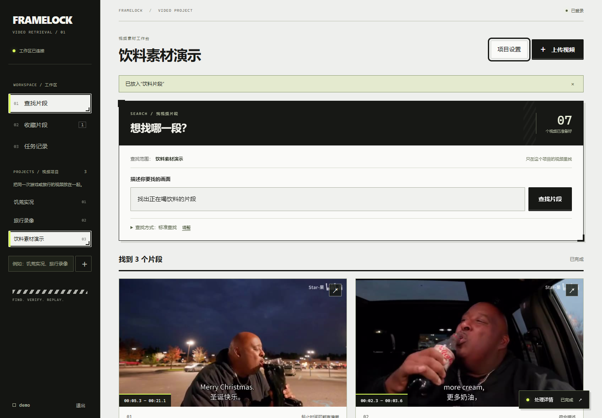
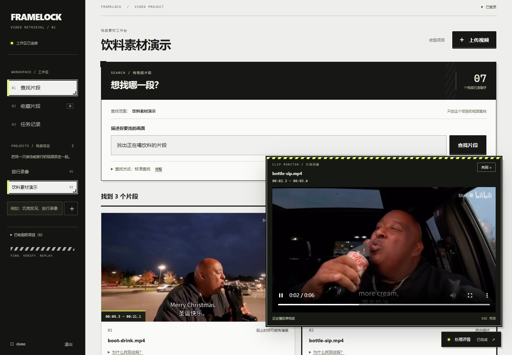
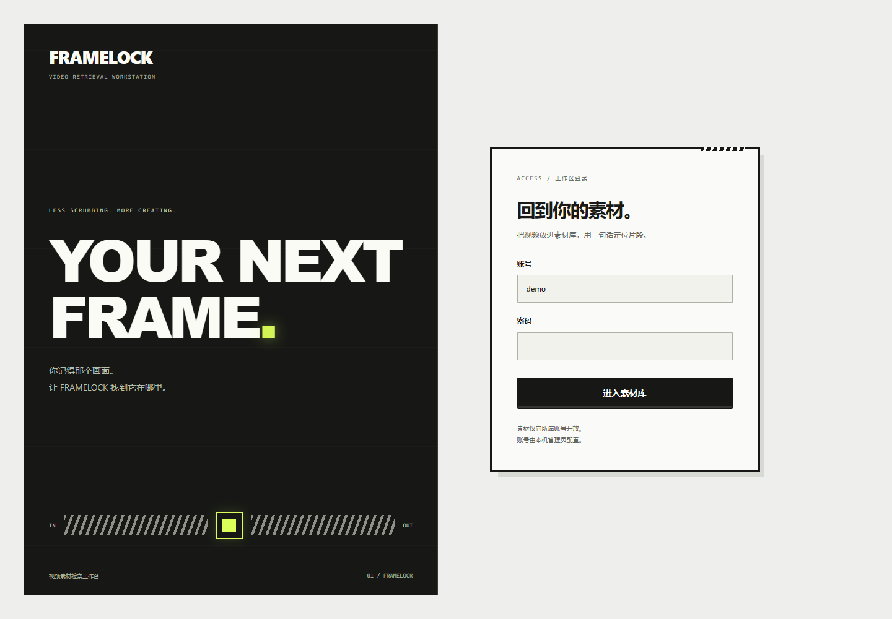
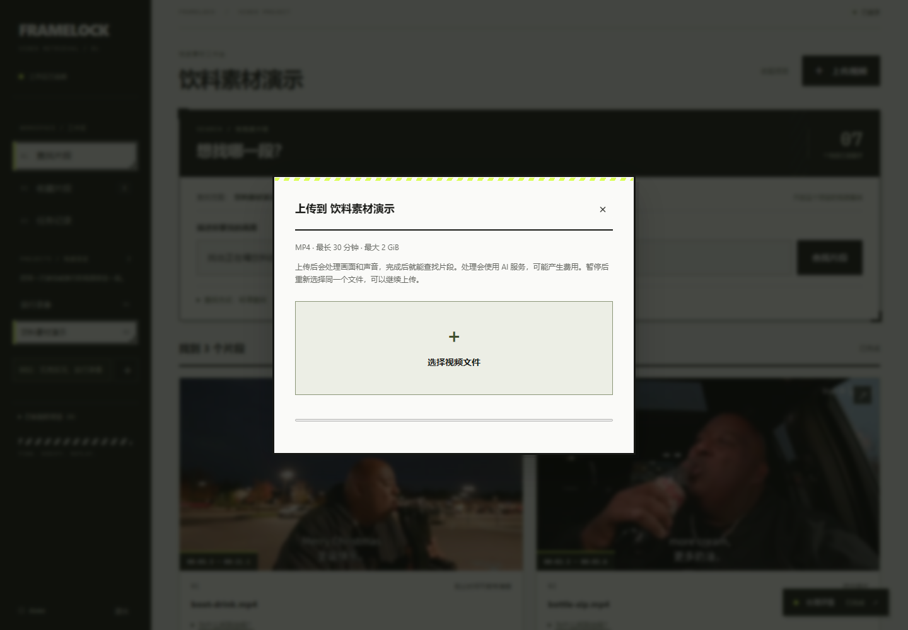
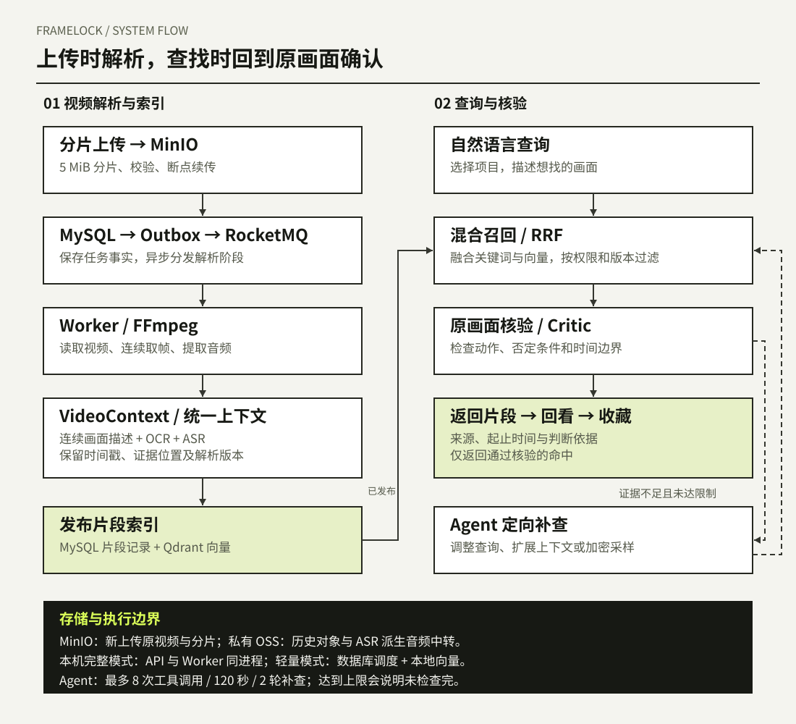

<div align="center">

# FRAMELOCK

**拍了很多视频素材却找不到要用的那一段？你一句话，FRAMELOCK帮你锁定视频里的那一幕。**


[界面预览](#界面预览) · [工作原理](#工作原理) · [本机运行](#本机运行) · [实测结果](#实测结果)

</div>

FRAMELOCK 帮助视频创作者从多个素材文件中找到想要的画面。上传视频后，用一句话描述目标，系统返回对应视频、起止时间和判断依据，点击即可回看。

**创建项目 → 上传视频 → 描述画面 → 回看片段 → 分类收藏**

不同项目的视频分开查找，例如“游戏实况”和“旅行录像”。结果不够具体时可以接着提问，有用的片段可以放进收藏夹，处理进度和历史查询也能随时查看。

当前支持 H.264 MP4，每个项目最多 10 个视频，单个最长 30 分钟、最大 2 GiB。

## 界面预览

### 视频素材工作台



选择视频项目后，输入“找出正在喝饮料的片段”。系统先从已有索引召回候选，再读取原始画面核验；结果显示时间区间和画面依据，点击即可在浮动播放器中回看。确认有用的片段可以选择收藏夹保存，之后还能移动到其他收藏夹或“未分类”；同一片段不会重复收藏。检索期间也可以打开任务窗口查看执行轨迹。

### 片段回看与任务窗口



页面以黑白面板和粗细线条区分层级、选中与播放状态，少量荧光用于状态灯和边缘反馈。播放器、任务详情和上传窗口独立浮起；支持窄屏布局，并尊重系统的减少动态效果设置。

<details>
<summary>查看登录与上传界面</summary>





</details>

## 核心功能

视频查找有两个不同的问题：先找到可能相关的位置，再判断画面里是否真的发生了目标动作。FRAMELOCK 将它们分成索引、召回和原画面核验，耗时处理则由持久化任务驱动。

### 视频上传与多模态解析

- **分片续传**：按 5 MiB 上传，保存分片回执与校验结果；断网后继续上传，合并完成即返回解析任务。
- **连续画面理解**：FFmpeg 提取带时间标签的连续画面，视觉模型描述动作，OCR 补充画面文字，ASR 转写语音，统一保存为 VideoContext。
- **解析结果复用**：画面描述独立于搜索问题生成，换一种问法时复用已有索引；每个片段保留视频、解析版本、整数毫秒时间及证据位置，只检索已发布版本。

### 跨视频检索与时间定位

- **混合召回**：在当前项目中分别进行关键词和向量检索，通过 RRF 融合候选，减少仅靠字幕或单一路径查找的遗漏。
- **原画面核验**：重新读取候选位置的画面，区分“提到了喝饮料”“拿着杯子”和“实际饮用”，通过核验后才返回命中。
- **片段回看**：结果显示来源、起止时间和判断依据，点击直接跳转；边界不确定时明确标注，便于人工确认。

### 有证据约束的 Agent 补查

- **角色分工**：Planner 通过 LangChain4j 选择工具，Executor 执行检索或检查，Critic 对照原画面判断证据是否充分。
- **定向补查**：证据不足时调整查询、扩展邻接范围或加密采样；普通模式执行固定核验，Agent 模式最多执行两轮补查。
- **执行上限**：一次搜索最多八次工具调用、120 秒。达到限制时区分“没有找到”和“还没检查完”，已核验的片段仍可回看。
- **继续追问**：围绕当前结果缩小条件，服务端保留项目及视频范围；Redis 保存最近五轮、24 小时过期，父搜索信息仍保存在 MySQL。

### 持久任务与故障恢复

- **异步处理**：MySQL 保存阶段状态，RocketMQ 在完整模式中分发任务；Outbox 补发已提交但尚未发送的事件，阶段结果持久化后才确认消息。
- **幂等与恢复**：唯一约束和条件更新约束重复执行；租约及执行代号防止旧 Worker 覆盖新结果，检查点保留已完成阶段和剩余预算。
- **进度与撤权**：SSE 推送进度，断线后读取持久状态；取消阻止后续调度，删除先撤销访问，再异步清理对象与索引。

### 模型费用与调用记录

- **调用前预留**：先预留费用，再按用量估算结算；超时且计费不明的请求保留预留，不按零费用处理。
- **缓存与追踪**：媒体哈希、采样参数、模型和提示词版本组成缓存键；任务轨迹保留工具、证据、耗时与费用估算。
- **实验预算**：首轮预算 30 元，已结算及预留达到 27 元后停止新调用；OSS 费用单独计算，实际收费以供应商账单为准。

### 项目与收藏整理

- **按项目查找**：不同游戏或拍摄主题分开管理，项目可改名；仅允许删除没有视频和未完成上传的空项目。
- **分类收藏**：收藏片段保留来源项目，可移动到其他收藏夹；删除收藏夹后片段回到“未分类”，原视频不受影响。
- **恢复历史查询**：处理记录保留原问题、项目和时间，打开后恢复查找范围；标准查找无结果时可直接选择“多找一轮”。

## 工作原理

<p align="center">
  <a href="video-search/docs/images/architecture.svg">
    
  </a>
</p>

[打开完整流程图](video-search/docs/images/architecture.svg) · [Mermaid 源码](video-search/docs/architecture.mmd)

新上传的原视频与分片默认保存在 MinIO；历史 OSS 对象仍可读取，ASR 派生音频通过私有 OSS 的短期链接交给转写服务。

后端采用模块化单体，API 与 Worker 使用同一制品。本机完整模式在同一后端进程中运行 API 与 Worker，通过 RocketMQ 分发任务、Qdrant 检索向量；轻量模式使用数据库持久队列和本地向量计算。另提供 API/Worker 分容器配置，该部署方式尚未验收。

## 技术栈

| 层次         | 技术                                        | 用途                               |
| ------------ | ------------------------------------------- | ---------------------------------- |
| 页面         | Vue 3、Vite、SSE                            | 上传、素材管理、片段回看与任务轨迹 |
| 后端         | Java 21、Spring Boot 3.5.9 / Undertow、Spring Security | REST API、Session、CSRF 和权限隔离 |
| 数据         | MySQL 8.4、MyBatis-Plus、Flyway             | 业务事实、上传回执、阶段状态和迁移 |
| 异步与协调   | RocketMQ 5.3.4、Redis、Redisson             | 完整配置的阶段分发、限流和合并互斥 |
| 媒体与索引   | MinIO、FFmpeg、Tesseract、Qdrant                    | 对象存储、取帧、向量索引           |
| 模型与 Agent | LangChain4j、Qwen3-VL、Fun-ASR、Embedding   | 工具调用、视觉核验、转写和语义召回 |
| 部署         | Docker Compose                              | 依赖与 API / Worker 编排           |

## 本机运行

### 环境与配置

需要 Java 21、Maven 3.9+、Node.js 22.12+、Python 3、FFmpeg，以及 Docker Compose。本轮支持 Windows＋WSL2，发行版内运行 Docker Engine 与 Compose。Java、Maven、FFmpeg 和 WSL 发行版通过环境变量或 PATH 解析，配置见[运行说明](video-search/README.md)。

共享云配置保存在根目录 `.env`，应用账号与数据库密码保存在 `video-search/.env`；后者覆盖前者的同名配置。配置字段见 [`.env.example`](video-search/.env.example)。密钥、密码和运行数据不提交到仓库。

### 构建与启动

日常使用时，双击工作区根目录的 **`启动FRAMELOCK.cmd`**。它会启动数据库和应用，等两者就绪后打开浏览器；启动窗口关闭后，应用继续在后台运行。重复双击会打开已有服务，不会重复启动。

重启电脑后需要再双击一次。用完可以双击 **`停止FRAMELOCK.cmd`**，视频、收藏和数据库都会保留。

也可以在工作区根目录执行：

```powershell
./video-search/scripts/launch.ps1
```

打开 **http://127.0.0.1:8090/**。登录账号和密码分别取 `video-search/.env` 的 `VS_ADMIN_USER`、`VS_ADMIN_PASSWORD`。

`/health` 返回应用及数据库均为 `UP` 时，页面才会自动打开。启动出错时查看 `video-search/output/api-background.log` 和 `api-background-error.log`。修改代码后，先停止应用，再运行 `build.ps1` 构建，最后重新启动。

默认轻量模式使用 MySQL、MinIO、数据库调度和本地向量检索。双击 `启动FRAMELOCK完整模式.cmd` 使用 Redis、RocketMQ 与 Qdrant，切换模式前先停止应用。真实组件和独立 MySQL 整链已验证，整链模型使用零费用替身；分容器 API/Worker 部署仍未验收。技术对照与验证边界见[技术实现说明](video-search/docs/technical-design.md)。

### 体验一次检索

首次启动时没有预置项目或视频。先按[运行说明](video-search/README.md#从公开源码开始)准备配置，再完成以下操作：

1. 创建一个视频项目，例如“试用素材”，上传自己有权使用的短视频。首次试用建议选择动作清楚、时长较短的 H.264 MP4。
2. 等待视频处理完成。解析需要自行配置模型和 OSS 凭据，会调用云服务并计入费用；失败时打开任务详情查看原因。
3. 描述视频里实际发生的动作，点击“查找片段”。例如上传了饮料视频，可以搜索“找出正在喝饮料的片段”。
4. 点击结果回看对应时间，确认有用后保存到收藏夹。标准查找没有结果时，可以点击“多找一轮”；返回结果取决于上传内容及核验情况。

截图中的“饮料素材演示”是本机开发数据，不随仓库提供。历史样本的离线评测需要额外准备私有样本、标注、查询和已有预测，具体条件见[测试与验收说明](video-search/docs/evaluation/README.md#真实视频与模型实验)。普通测试会自行生成输入，运行 `./video-search/scripts/build.ps1`；真实中间件整链测试运行 `./video-search/scripts/verify-stack.ps1`，模型使用零费用替身。

## 发布与复现

公开仓库不包含私有视频、运行数据和临时面试资料。普通测试自行生成输入；真实中间件整链使用 FFmpeg 合成视频和模型替身。运行方式、公开验收摘要与真实模型实验限制见[测试与验收说明](video-search/docs/evaluation/README.md)。

Agent 模式先检查最多两个候选，为补查保留次数；普通模式首轮仍最多检查五个。两种模式都保留八次工具和 120 秒限制。达到限制时，页面区分“这次没找到”和“还没有检查完”，已核验的片段仍可回看。

## 实测结果

当前评测来自七段饮料开发样本、十二条查询，其中四条没有答案。素材全部参与过开发，不能将这些数字解释为对未知视频的泛化能力。

| 路径                         | 正例宏平均 Recall@5 | Precision@5 | 四条无答案误报 |
| ---------------------------- | ------------------: | ----------: | -------------: |
| 静音样本 OCR-only            |                   0 |           0 |              0 |
| 服务 v1：视觉描述 + 固定核验 |              0.9375 |         1.0 |              0 |
| 服务 v1：视觉描述 + Agent    |              0.9375 |         1.0 |              0 |

这组数据没有显示 Agent 的召回提升。两条视觉路径的起点误差中位数为 100 ms，但最坏达到 5000 ms；后续邻接范围修复改善了该单例，尚未重跑整组对照。100 ms 是边界附近的采样间隔，不是准确率承诺。Agent 复用了预热缓存，耗时也不能与固定核验直接比较。

工程侧测试结果见[发布准备验收记录](video-search/docs/evaluation/release-readiness.json)。真实验证包括 36.52 MiB 视频的八分片断网续传、视觉处理期间终止 JVM 后恢复、删除撤权及 SSE 重连；模型替身测试与真实中间件结果分别标注。评测和故障证据见[验收记录](video-search/docs/verification.md)。

尚未完成分容器 API/Worker 部署、独立素材集与《饥荒》场景验证，也没有通过上传十个半小时视频验证吞吐。容量上限是当前业务约束，大文件持续处理能力仍需单独验收。

## 代码与文档

```text
video-search/
├── server/        Java API、Worker 与测试
├── web/           Vue 工作台
├── deploy/        Compose 与中间件配置
├── scripts/       构建、启动、实验与验证入口
├── samples/       本机开发样本和标注，不提交
├── tools/         本机 FFmpeg 及发行说明
├── docs/          架构、验收、实验与规划
├── output/        本机评测结果与验收证据，不提交
└── .data/         运行数据、模型缓存与费用账本，不提交
```

[架构与实现](video-search/docs/implementation.md) · [验证与边界](video-search/docs/verification.md) · [工作区维护](video-search/docs/workspace.md) · [开发清单](video-search/docs/planning/video-search-tasks.md)

使用动线的检查与处理进展见[流程检查](video-search/docs/user-flow-review.md)。

## Star History

[](https://www.star-history.com/#glommmmer/FRAMELOCK&Date)

图表由 Star History 提供；若图片暂未显示，可点击进入图表页面查看。
