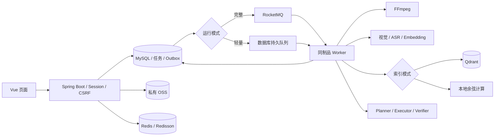

# 当前技术栈

2026-11-26 已迁移至 Spring Boot 3.5.9 / Undertow、MinIO、RocketMQ / Redisson Starter、统一 VideoContext、Planner / Executor / Critic 及 Redis 追问记忆。当前实现及验证范围以[技术实现说明](technical-design.md)为准。以下内容保留此前设计与验收背景，其中 OSS、Verifier 与仅轻量运行的描述属于改造前状态。

# 架构与面试说明

## 运行结构

Java 21 / Spring Boot 3 模块化单体，包名 `dev.videosearch`。API 与 Worker 使用同一 JAR，完整模式通过 `VS_WORKER_ENABLED` 决定是否消费。轻量模式显式设置 `VS_DISPATCHER=local`、`VS_INDEX_MODE=local`，不应算作 MQ/Redis/Qdrant 联调。

## 事实与约束

| 表 | 用途与约束 |
| --- | --- |
| vs_user / vs_library | 账号与素材库；BCrypt；owner 索引 |
| vs_upload | 声明大小/SHA、合并状态、执行代号、租约、24h 过期 |
| vs_upload_part | `(upload_id, part_no)` 主键，SHA 和对象键 |
| vs_upload_object | 先登记对象写入意图，精确记录未形成回执的对象键，无需列举 Bucket |
| vs_video | 原始媒体、删除标记、active_version、index_execution_id |
| vs_task | 阶段、父任务、输入/检查点、执行代号、租约、结果、错误 |
| vs_outbox | 已提交但待投递的事件 |
| vs_segment | 窗口、描述/OCR、证据、向量、版本；窗口唯一 |
| vs_transcript | 带时间 ASR 句 |
| vs_favorite | 用户与片段、可空的收藏夹归属；相同收藏唯一 |
| vs_favorite_folder | 用户自己的收藏夹；同一账号下名称唯一 |

Flyway V1 至 V6 迁移，V4 保存项目显示设置，V5 增加收藏夹，V6 为项目添加软删除标记。素材库创建使用 MyBatis-Plus，关键条件更新使用 JdbcTemplate 与事务模板，使租约和状态转换明确可见。

收藏夹使用 `POST/GET /api/v1/favorite-folders` 创建和读取，收藏提交可带 `folderId`；`PATCH /api/v1/favorites/{id}/folder` 移动现有收藏，空值表示未分类。收藏与目标夹都检查所属账号，重复收藏同一时间片段只调整归属，不生成第二份；移动不改视频和时间范围。

项目与收藏夹分别支持 `PATCH/DELETE /libraries/{id}`、`PATCH/DELETE /favorite-folders/{id}`。项目锁与上传初始化使用相同的数据库行锁，项目有视频或未完成上传时拒绝删除；软删除保留历史名称与关联。删除收藏夹先锁定目标，再将其中收藏移回未分类，最后删除空夹；与收藏和移动操作的锁一致。

`SearchContext` 为历史结果、任务列表和详情补充所属项目、原问题、模式和项目删除状态；解析查询时只读取当前账号拥有的项目。搜索创建和任务重试共用已发布索引检查。前端恢复历史会同步范围与输入，并用请求序号阻止迟到历史响应或旧 SSE 改写新选择。

## 上传、处理和恢复

库行锁将正在上传的任务也计入十个名额。先在 MySQL 登记对象写入意图，写分片后再记录回执；相同 SHA 重传幂等，不允许替换不同内容。合并时验证完整大小/SHA、H.264 MP4 和时长，再事务提交视频、父解析任务和 Outbox。Redisson 只减少重复合并，不能代替数据库约束。

PROBE 创建 10 秒窗口、5 秒步长的 VISUAL 子任务，以及有音轨时的 ASR 子任务。ASR 提交与轮询分别持久化，不占线程等待云任务。视觉失败阻止发布，ASR 失败允许 READY_PARTIAL。向量写完后才提交 active_version/index_execution，半成品不可见。

任务 Claim 使用状态条件更新领取执行代号和租约。成功结果与阶段状态同事务提交；过期、被取消或被替换的执行不能写入。心跳不能复活过期租约。Outbox 重投与重复消费都由 Claim 幂等保护。取消父任务传播给未完成子任务；中断在途请求仍可能计费。

Qdrant 点 ID 包含片段与执行代号，payload 过滤 owner/library/version/execution/video；指定视频直接下推到 Qdrant filter，数据库当前授权视频的交集再过滤一次。向量与数据库不做分布式事务，用“先建索引、后发布”控制可见性。

删除先写数据库撤权，旧检索 GET 过滤已删除视频；后续清理原对象、分片、音频和向量。宿主机派生帧/转码缓存还没有按对象 GC，不暴露为静态目录。SSE 只通知，重连仍读取持久事实。

FFmpeg 每进程并发一，云适配每进程并发二；轻量 Worker 单线程。额外工作留在任务表，不随视频数量无限创建线程。

## 检索与 Agent

视觉/OCR、语音和向量分别召回，RRF `1/(60+rank)` 融合前二十，核验前五。Java 合并同视频、同版本重叠区间，最多返回五段。

Planner 通过 LangChain4j Function Calling 提出动作，Executor 只接受工具枚举与已授权候选 ID；模型没有 owner/library 参数。工具为 searchVisualDescriptions、searchTranscript、inspectClip、expandContext。补查词只影响召回，Verifier 始终读取原查询，不能放宽硬条件。

状态机限制 120 秒、八次工具调用、两轮补查。检查点保存匹配与轨迹，进程恢复沿用原期限；手动重试失败搜索才重开期限。首版恢复会重做召回，保留工具计数，可能更早达到上限并返回已有匹配，这是明确取舍。

500 ms 核验后，在边界附近以 100 ms 采样细化；保留粗区间和边界依据，不能确认时返回 boundaryConfirmed=false。时间越界不能覆盖原已核验区间，采样精度不能宣传为准确率。

## 预算

跨进程文件锁保护共享费用账本；先预留，收到用量后按公开价估算，未知费用保留预留。账本依赖完整模式共享数据卷。缓存键包含帧、采样、模型和提示词。27 元停止线加 3 元误差缓冲，OSS 另计，不自动换更贵模型。

视觉与 Planner 用北京 qwen3-vl-plus，Embedding 用 text-embedding-v4 1024 维，ASR 用 fun-asr。ASR 按已探测音频秒数保守估算，供应商账单另核。依据：[模型价格](https://help.aliyun.com/zh/model-studio/model-pricing)、[Function Calling](https://help.aliyun.com/zh/model-studio/qwen-function-calling)。已有真实工具调用记录，不仅是 SDK 依赖。

## 面试讲解与简历

先解释“记得发生了什么，但不知道在哪个视频的哪一秒”，演示饮用、倒饮料和无答案，再讲查询独立解析、候选召回与原画面核验，最后挑一个可靠性问题深入。

| 追问 | 结合代码回答 |
| --- | --- |
| 分布式锁为何不足以保证幂等？ | 失锁、重启、重复消息仍需数据库状态、唯一约束与执行代号 |
| Redis 挂了呢？ | 任务事实在 MySQL；合并可回数据库隔离，不能声称仍有分布式限流 |
| MQ 重复或 Worker 挂掉？ | Claim 幂等、租约恢复、新执行领取、旧执行不能提交 |
| Qdrant 部分写成功？ | 发布版本前不可见；执行代号隔离旧点 |
| Agent 有什么必要？ | 根据失败证据补查，没证据就结束；权限、预算、期限由服务器控制 |
| 如何处理幻觉？ | 工具白名单、候选校验、原目标不变、重读原画面，不用自信文案代替依据 |

基于已测结果的简历草稿：

开发 Java 21 / Spring Boot 视频检索应用，实现私有 OSS 分片上传、MySQL 持久任务、查询独立视觉索引、RRF 召回与原画面核验，接入 LangChain4j Function Calling 的有界补查。七段开发样本、十二条查询宏平均 Recall@5 为 93.75%，四条无答案无误报；使用真实 MySQL/OSS/模型和浏览器验证上传、跨视频回看、收藏、SSE 重连及删除撤权。

不要写完整中间件压测通过、百万并发、未知游戏泛化或 100ms 定位准确率。

实际权限修复：私有 OSS 允许写、读、删，不允许 ListBucket。首次过期清理失败后，改成从回执和写入意图表取得精确对象键并删除，真实九个分片已清理，原视频完成状态保留。没有要求扩大凭据权限。

费用预留覆盖最大上下文：视觉单次预留 0.90 元，Planner 预留 0.85 元，收到用量后按上下文档位结算估算；未使用预留不当作实际消费。每个检索工具保存 modelUsage，本地缓存命中为零新增费用。
