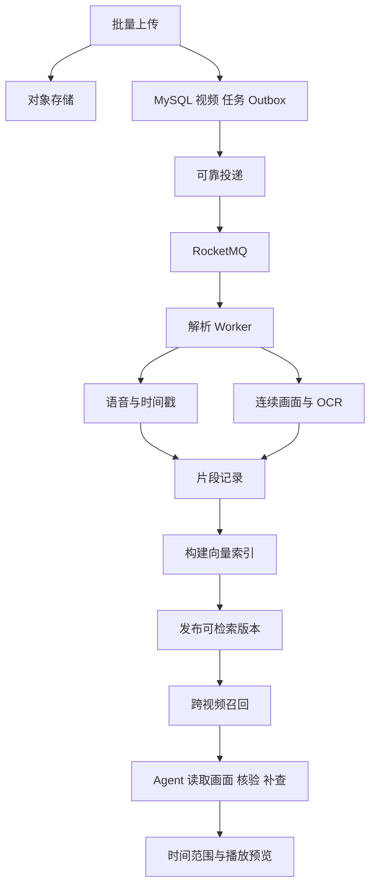

# 多视频片段检索项目实施方案

日期：2026-11-22。状态：轻量模式的业务、解析、Agent 与页面闭环已实现。完整 MQ/Redis/Qdrant 联调按用户最新要求跳过；当前结果以 `../../README.md` 和验证文档为准。

面向 Java 后端和 AI 应用岗位，实现上传、媒体处理、任务调度与 Agent，支持跨视频检索、画面核验和时间定位。首个技术实验使用“喝水”及干扰动作，随后用《饥荒》实况验证真实素材。产品服务于从自己的多个视频中查找素材的用户。

## 第一版范围

用户创建素材库、批量上传视频，输入一句话，得到视频来源、起止时间、缩略图、命中依据和可播放预览。支持任务查询、重试、取消、删除视频和收藏结果。没有可靠匹配时返回未找到；候选不足以确认时标记证据不足，不编造片段。

第一版不包含全网抓取、自动剪辑成片、视频生成、支付、公开素材交易、多人协作。片段下载后置，初期用原视频定位播放，避免每次检索都转码。

初始交互：素材库 → 上传与解析进度 → 输入查询和范围 → 结果列表与播放器 → 收藏。Agent 调用详情放任务详情中，不要求普通用户理解模型编排。

## 工程组织

后端按认证、视频项目、上传、解析、检索、Agent、任务和预算划分模块。前端包括项目、检索、播放器、收藏和任务记录。新业务使用独立数据库名称、对象前缀、Redis 前缀、MQ Topic 和 Qdrant collection。

现有配置、视频和业务记录保留；功能是否可用以实际验收记录为准。

## 技术选择

| 层 | 采用方案 | 边界 |
| --- | --- | --- |
| 后端 | Java 21、Spring Boot 3、MyBatis-Plus、Flyway | 工程初始化时统一依赖，清理重复 MQ 客户端和冲突依赖 |
| 业务数据 | MySQL | 用户归属、任务、片段、发布版本的事实来源 |
| 协调与缓存 | Redis、Redisson | 上传进度加速、限流、短期缓存、合并互斥；不能承担唯一恢复依据 |
| 异步任务 | RocketMQ | 分阶段投递、有界重试、失败台账、重复消费处理 |
| 文件 | 现有 OSS 适配 | 视频、音频、关键帧、缩略图；初期只维护一套存储后端 |
| 媒体处理 | FFmpeg、FFprobe | 子进程超时、取消、临时目录清理、原始时间戳 |
| 检索 | Qdrant + 本地关键词检索 | 先融合文本与视觉描述；ES 由检索实验决定是否引入 |
| 模型 | 视觉模型、ASR、Embedding 独立接口 | 模型名称、图片输入限制、价格与工具调用支持在实验时验证 |
| Agent | LangChain4j 接入 + 显式状态机 | 持久化检查点并限制执行预算；角色可共用模型 |
| 前端与部署 | Vue 3、Docker Compose、反向代理 | API 与 worker 可用同一制品按配置分开启动，不拆微服务 |

现有 `infra/compose.yml` 包含 ES、缺少 Qdrant，不能直接当作新部署文件。新的 Compose 在基础设施阶段单独编写，固定实际验证过的版本和持久化卷。先完成开发机资源检查，再确定实例数和线程池参数。

## 解析与检索设计

### 离线解析

1. 合并并核验视频，FFprobe 获取时长、分辨率、音视频轨道。
2. 创建解析版本和任务；事务内写入待发送事件。
3. 提取音频与带时间戳的转写；无音轨是合法情况，不因此让视觉解析失败。
4. 按时间窗口读取一组连续画面，生成可检索的动作和场景描述；OCR 独立保存。
5. 保存原始证据位置、时间范围、模型与提示词版本，为描述生成向量。
6. 完成全部必要写入后发布解析版本。单条查询只读取已发布且有权限的数据。

技术实验比较 1 秒与 2 秒采样、5 秒与 10 秒窗口及重叠窗口，不预先承诺最佳值。均匀采样与镜头变化采样作为候选；游戏镜头变化与真实事件未必一致，不能只依赖场景切换。

视频只解析一次并复用索引；用户每次搜索不重新解析整个素材库。重新解析生成新版本，旧版本继续提供结果，切换成功后再异步清理。

### 在线检索

1. 后端限定用户、素材库、选中视频与已发布版本。
2. 语音/OCR 关键词与片段描述向量分别召回，融合排序并去重。
3. 读取前若干候选的原始画面，核验动作及否定条件。
4. 必要时扩大时间上下文或加密取帧，修正开始和结束位置。
5. 合并同一事件的重叠命中，返回来源与原始证据。

Qdrant 的过滤条件由服务端注入，不能交给模型生成。返回前再检查视频归属、删除状态和解析版本，避免索引清理延迟造成越权或返回已删除视频。

时间统一使用整数毫秒，区间采用 `[startMs, endMs)`。画面抽取保存真实时间戳，播放器跳转、预览与评测使用同一坐标。先支持已验证的常见 MP4 编码；不能处理的格式明确返回原因。

## Agent 与工具

| 角色 | 输入和职责 | 输出 |
| --- | --- | --- |
| Planner | 用户查询、范围和工具能力；提取动作、对象、否定条件 | 结构化检索目标与初步策略 |
| Executor | 根据当前状态调用工具，收集候选与证据 | 工具结果、已搜索范围、候选片段 |
| Verifier | 对照原始连续画面核验，识别缺少的证据 | 接受、拒绝、补查建议及依据 |

首批工具：`searchTranscript`、`searchVisualDescriptions`、`inspectClip`、`expandContext`。时间区间合并用确定性代码执行，不让模型计算或猜测。工具参数经过类型、范围、所有权与资源上限校验。

可观察记录保存计划摘要、工具名、校验后参数、结果摘要、证据、耗时、Token 和退出原因；不要求保存模型私有推理过程。视频文字和语音仅作为数据，不能改变系统指令或授权范围。

初始实验上限：每次查询最多 2 轮补查、8 次工具调用、120 秒总期限；这些是保护参数，不是性能承诺。费用预算必须结合实际模型价格设置，执行前预留、调用后结算；预算保护不等于供应商账单硬封顶。

同时保留 A 字幕/OCR 检索、B 视觉描述检索加固定核验、C Agent 自适应补查三条实验路径。无须为简单查询强行触发所有角色。

## 任务与一致性

解析阶段为探测、转写、视觉解析、建索引、发布；阶段状态为 PENDING、RUNNING、RETRY_WAIT、SUCCEEDED、FAILED、CANCELLED。查询任务支持相同的执行状态。部分可选分支失败要显式标记能力缺失，不能假装完整成功。

- 消费幂等键包含视频、解析版本和阶段；MySQL 唯一约束作为最终防线。
- Worker 通过条件更新领取任务，保存执行代号、租约期限与心跳。恢复时产生新执行代号，旧 Worker 不能覆盖新结果。索引和对象键也包含版本/尝试范围，发布前校验当前执行代号。
- 阶段成功保存后才确认消息；耗时阶段拆成有限批次，独立设置请求和子进程超时。不能仅提交内存线程池后就确认成功。
- 暂时性超时有限重试，参数非法、资源删除等永久错误直接结束。记录失败原因并支持人工重试，积压不能靠不断消费失败来限流。
- Outbox 补发处理“数据库提交成功、MQ 发送失败”；补发允许重复，由消费者幂等处理。
- MySQL 保存可恢复任务；Redis 或 SSE 通知丢失不改变任务事实。重连先查当前状态，再继续接收通知。
- 取消采用持久化标记，下一次调用前检查；FFmpeg 子进程尽可能终止。在途供应商请求可能仍计费，返回也不能覆盖取消状态。
- 上传先完成分片存储，再记录确认；分片回执丢失时核对存储对象后补记。合并使用互斥锁、持久化完成记录和唯一约束，不只依赖 Redis 收据。
- 删除立即撤销查询与播放权限，后台清理对象、片段和向量；清理失败可重试。播放使用鉴权代理或短期签名，既有签名有效期决定撤权延迟。

初期分别限制 FFmpeg 并发、模型调用并发与用户任务数。队列有界，容量不足时进入持久化等待或返回明确的繁忙状态，不能无限堆积 Java 内存任务。

## 数据与接口草案

核心实体：用户、素材库、视频、上传任务、分片回执、解析任务、阶段执行、片段、检索任务、工具调用、检索结果、收藏和 Outbox。下一阶段根据现有表结构输出迁移，不在本方案中假定旧表可直接复用。

关键约束：`(upload_id, part_no)` 唯一；`(video_id, parse_version, stage, batch_no)` 唯一；任务更新携带状态与执行代号；结果关联片段版本。列表索引从 `user_id/library_id`、状态、创建时间及 ID 组合开始，用实际 SQL 和 EXPLAIN 验证。

| 接口草案 | 用途 |
| --- | --- |
| `POST /api/libraries` | 创建素材库 |
| `POST /api/uploads` | 初始化上传，返回分片规则 |
| `PUT /api/uploads/{id}/parts/{partNo}` | 上传分片，重复提交保持幂等 |
| `GET /api/uploads/{id}` | 查询已确认分片 |
| `POST /api/uploads/{id}/complete` | 完成上传并创建解析任务 |
| `GET /api/libraries/{id}/videos` | 查看视频与解析状态 |
| `POST /api/searches` | 创建普通或 Agent 检索任务 |
| `GET /api/searches/{id}` | 查询状态和结果 |
| `GET /api/tasks/{id}/events` | SSE 进度通知 |
| `POST /api/tasks/{id}/cancel` | 请求取消 |
| `POST /api/tasks/{id}/retry` | 重试失败任务 |
| `DELETE /api/videos/{id}` | 删除与撤权 |

检索请求至少包含 `libraryId`、可选 `videoIds`、`query`、`mode`。结果至少包含 `videoId`、`segmentId`、`parseVersion`、`startMs`、`endMs`、证据引用和核验状态。模型分数不标成“正确概率”。

## 里程碑与交付顺序

| 阶段 | 交付物 | 进入下一阶段的条件 |
| --- | --- | --- |
| M0 视觉检索实验 | 本地实验入口、标注样本、三条基线、实验报告 | 连续画面能区分动作和干扰；达不到则先修采样或模型 |
| M1 上传与数据基础 | 新业务表、素材库、上传续传、权限、播放 | 断网续传、重复完成、越权、残留清理通过 |
| M2 可靠解析 | MySQL/Redis/MQ/Qdrant 实际联调、阶段恢复、索引发布 | 重复消息、进程终止、索引失败恢复通过 |
| M3 Agent 检索 | 工具调用、核验、补查、检查点、预算与取消 | 能展示基于证据改变检索行为，返回可回看片段 |
| M4 产品闭环 | 四个页面、批量素材、收藏、删除和错误反馈 | 新用户可以完成上传到查找的完整流程 |
| M5 部署与面试材料 | Compose、日志指标、评测报告、故障演示、架构与实现说明 | 按文档可部署，实际指标和限制可复现 |

不以固定天数代替阶段验收。算法与 Java/Spring 基础单独学习，项目不能替代基础题和手写算法训练。

## 面经对应的实现证据

| 追问主题 | 需要留下的证据 |
| --- | --- |
| 为什么选这个项目 | UP 主找素材的完整任务，真实使用反馈；测试动作不等于市场验证 |
| 分片大小为什么这样选 | 不同大小下的上传开销与失败重传实验，初始 5 MiB 只是候选值 |
| Redis 挂了怎么办 | 从持久化记录和存储核对恢复的演示 |
| MQ 重复、积压、消费超时 | 重复消费测试、阶段超时、队列最老任务年龄、受控并发 |
| 锁失效与并发写 | 数据库唯一约束、状态条件更新、过期 Worker 写入拒绝 |
| 线程池参数怎么来 | 本机资源、FFmpeg CPU/内存、供应商限额和排队观测 |
| SQL 索引与慢查询 | 素材列表和任务领取的执行计划与实际查询耗时 |
| Agent 比单次模型好在哪里 | 同一测试集的 A/B/C 对照、质量和成本变化 |
| 如何处理幻觉与无答案 | 原画面证据、负样本误报统计、工具参数与权限校验 |
| 10 倍流量瓶颈 | 解析和查询分别测量；先看模型配额、CPU、队列，再谈扩容 |

不添加库存、支付来凑面试点；逻辑过期等方案只有发生相应缓存需求时再采用。

## 下一项执行任务

开始 M0：检查媒体工具与本地接口，建立样本清单和人工标注，先实现无需模型的媒体探测、取帧、结果回看与评测入口，再接小样本视觉调用。付费调用前先列明模型、样本数量、预计调用量和预算，并遵守当时用户授权；本次仅建立计划，不调用云服务。

任务清单见 `video-search-tasks.md`，样本与评测规则见 `video-search-evaluation.md`。

## 技术参考

- [LangChain4j 工具调用](https://docs.langchain4j.dev/tutorials/tools/)。
- [RocketMQ 重复消费与消费实践](https://rocketmq.apache.org/docs/best-practice-consumer/)。
- [RocketMQ 消费重试](https://rocketmq.apache.org/docs/featureBehavior/10consumerretrypolicy/)。
- [Qdrant 过滤](https://qdrant.tech/documentation/search/filtering/)。
